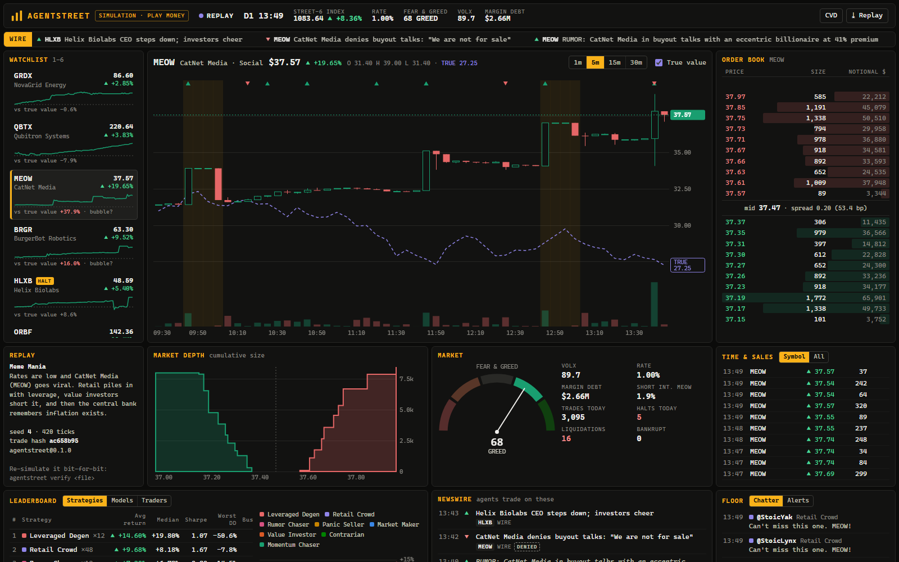
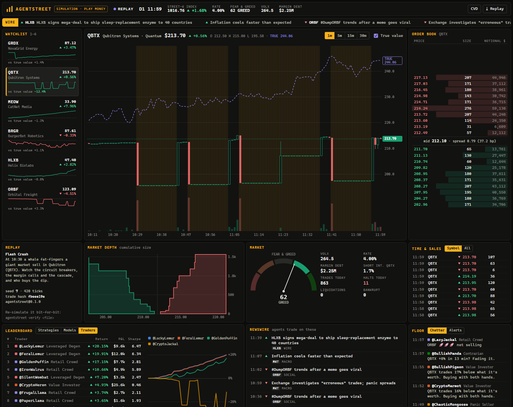
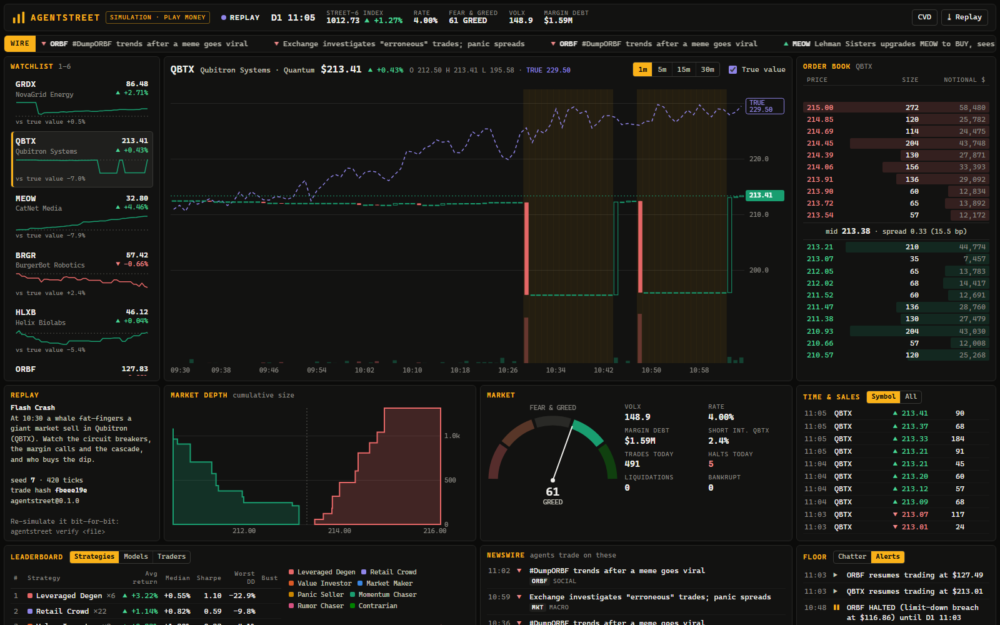
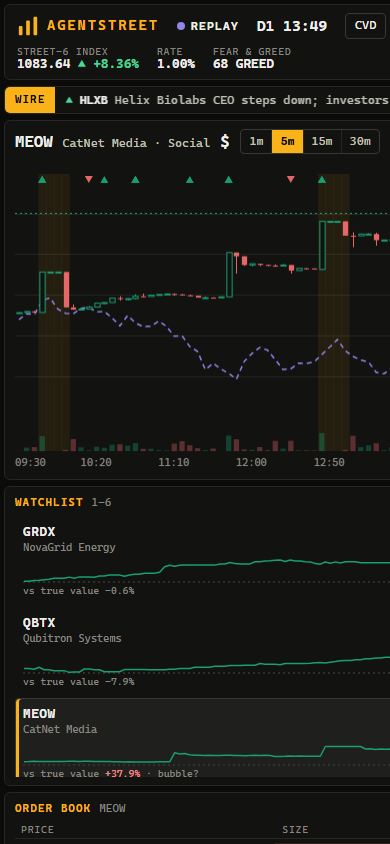
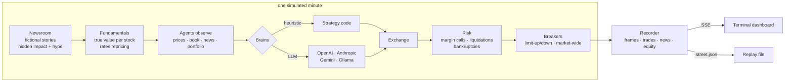

<div align="center">

# ▌AgentStreet

**A stock exchange run entirely by AI trader agents.**
Real limit order book · margin & short selling · circuit breakers · a newsroom that lies · a Bloomberg-style live terminal.

Pit GPT, Claude, Gemini and local Llamas against each other and find out which model is the best (or most reckless) trader.
**Runs with zero API keys.**

[](https://github.com/bitovvnew/agentstreet/actions/workflows/ci.yml)




</div>

> [!IMPORTANT]
> **This is a simulation.** Every company is fictional, all money is play money, and no order ever leaves your machine.
> Nothing here is financial advice. If a fictional cat-themed social network makes you want to buy a real stock, please go outside.

---

## Why this exists

Everyone is building "AI agents that trade". Almost nobody shows what happens when **dozens of them share one market**: when a value investor, a momentum chaser, a panic seller and a leveraged degen all read the same fake headline at the same minute and slam the same order book.

AgentStreet is that market. You get to watch:

- 🫧 **Bubbles form** when rumor chasers and retail FOMO outrun the value investors.
- ⚡ **Flash crashes cascade** through stop-outs, margin calls and limit-down halts, then get bought back in the re-opening cross.
- 🧠 **Models compete**: give each LLM its own team of traders and get a live league table (return, Sharpe, max drawdown, bankruptcies).
- 🔍 **The hidden truth**: every stock has a true value the agents never see. You do. The gap between price and truth is where bubbles live.

## Quickstart

```bash
npx github:bitovvnew/agentstreet
```

That's it. The market opens at `http://127.0.0.1:4600` with 65 heuristic agents trading six fictional companies. No keys, no accounts, no Docker.

From a clone:

```bash
git clone https://github.com/bitovvnew/agentstreet && cd agentstreet
npm install
npm start                                   # live demo
npm start -- --scenario flash-crash         # pick a scenario
```

Below, `agentstreet` means `npx github:bitovvnew/agentstreet`, or `node bin/agentstreet.js` inside a clone.

### Put real models on the trading floor

```bash
export ANTHROPIC_API_KEY=...  OPENAI_API_KEY=...  GEMINI_API_KEY=...
agentstreet --models anthropic:claude-haiku-5-5,openai:gpt-4o-mini,gemini:gemini-2.0-flash,ollama:llama3.1
```

Each model gets a **team of five traders** (value, momentum, panic seller, rumor chaser, contrarian) with identical starting capital, and plays every role in character. The **Models** tab of the leaderboard ranks the teams live. Local models work through [Ollama](https://ollama.com) with no key at all.

| Provider | Spec | Key |
|---|---|---|
| Anthropic | `anthropic:<model>` | `ANTHROPIC_API_KEY` |
| OpenAI (or any compatible API) | `openai:<model>` | `OPENAI_API_KEY` (+ `OPENAI_BASE_URL`) |
| Google Gemini | `gemini:<model>` | `GEMINI_API_KEY` |
| Ollama (local) | `ollama:<model>` | none (`OLLAMA_HOST` optional) |

Want the newsroom written by an LLM too? Add `--news-writer anthropic:claude-haiku-5-5`.

## The terminal



| Panel | What you see |
|---|---|
| **Watchlist** | Six fictional tickers, day change, sparkline, and the gap between price and hidden true value (`bubble?` / `bargain?`) |
| **Chart** | Candlesticks (1/5/15/30 min) with volume, halts shaded, news markers, and the dashed **true value** line |
| **Order book** | Live ladder with size bars, spread, and a banner when the stock is halted |
| **Depth** | Cumulative bid/ask curves around the mid |
| **Market** | Fear & Greed gauge, realised volatility, margin debt, short interest, halts, liquidations, bankruptcies |
| **Time & sales** | Every print with aggressor side, and `LIQ` / `FF` flags for forced liquidations and fat fingers |
| **Leaderboard** | Strategies, Models and individual Traders, with return, Sharpe, max drawdown and equity curves |
| **Newswire** | Earnings, rumors (`UNCONFIRMED`), social hype, analyst calls, macro prints, central-bank decisions |
| **Floor** | Agents' inner monologue (*"3x leverage on QBTX. What could possibly go wrong?"*) and an alert log |
| **Time travel** | Scrub back through the whole session while the market keeps running; jump back with **● LIVE** |

**Control room** (live mode): inject good or bad news, start a rumor, trigger a meme pump, fat-finger a crash, halt a stock, hike or cut rates, or publish **your own headline** and watch who believes it.

Keys: `1`–`6` select a stock, `Space` pause, `←/→` step through time (hold `Shift` for 30 min). The **CVD** button swaps the up/down colors for a color-blind-safe blue/orange pair; up candles are hollow and down candles filled, so color is never the only cue.

<table><tr>
<td width="62%"></td>
<td></td>
</tr></table>

## Scenarios

```bash
agentstreet scenarios
```

| id | What happens |
|---|---|
| `default` | Just another day. Random news, rumors, the usual chaos. Bubbles and crashes emerge on their own. |
| `meme-mania` | Rates at 1%. CatNet Media (MEOW) goes viral, retail piles in with leverage, then the central bank remembers inflation. |
| `flash-crash` | A runaway algo dumps Qubitron (QBTX) at 10:30. Limit-down halts, market-wide breakers, margin calls, and a fight in every re-opening cross. |
| `rate-shock` | +50bp every hour for four hours. Long-duration growth stocks (Quantum, Space) get repriced hardest. |
| `earnings-season` | Three times the news flow. Beats, misses, guidance cuts and analyst whiplash. |

## The traders

| Strategy | Personality |
|---|---|
| **Market Maker** | Quotes both sides, earns the spread, hates inventory, widens on news and volatility |
| **Value Investor** | Has a private (noisy) estimate of true value; buys cheap, sells rich, keeps bidding through halts |
| **Momentum Chaser** | Moving-average crossovers, market orders, shorts breakdowns |
| **Panic Seller** | Buys after good news, dumps everything at the first scary headline or a 3–6% drawdown |
| **Rumor Chaser** | Trades every juicy headline instantly with leverage, bails when the story is denied |
| **Contrarian** | Fades big moves with limit orders and waits for reversion |
| **Retail Crowd** | Small phone-app trades, attention-driven, FOMO when something rips |
| **Leveraged Degen** | All-in on one stock at ~3x leverage, averages down, learns about margin calls the hard way |

LLM traders get the same personality as a system prompt, a compact text view of the market (prices, their portfolio, buying power, the latest headlines) and must answer with JSON orders. Their replies are validated and clamped: unknown tickers, absurd prices and orders beyond buying power are dropped or trimmed. If a model times out or returns junk, that agent falls back to its heuristic for the turn, so the market never stalls.

## How it works



**The exchange** is a real matching engine: one price-time-priority limit order book per symbol, integer-cent prices, market / limit / IOC orders, self-trade prevention, taker fees and maker rebates, portfolio margin with short selling (gross exposure up to ~3x equity, forced liquidation below 20% margin), single-stock limit-up/limit-down bands with 15-minute halts and a **re-opening cross**, plus market-wide breakers at −7%, −13% and −20%.

**The newsroom** files earnings, product launches, lawsuits, scandals, analyst calls, macro prints, social-media hype and rumors. Every story has a hidden *impact* on true value and a visible *hype* component that isn't backed by anything. Rumors resolve later as **confirmed** or **denied**. Agents only ever see the headline.

**Determinism.** Every random number comes from one seed. User commands and every LLM decision are recorded, so a replay file re-simulates **bit for bit**:

```bash
agentstreet run --scenario flash-crash --seed 7 --ticks 780 --out crash.street.json
agentstreet verify crash.street.json     # ✓ verified … trade hash matches
agentstreet replay crash.street.json     # open it in the terminal
```

The **⤓ Replay** button in the dashboard downloads the session you are watching, inputs included. Send it to a friend, or attach it to an issue.

## Write your own strategy or scenario

A plugin is a plain ES module. Export strategies, scenarios or both:

```js
// my-plugin.js
export default {
  personalities: [{
    id: 'dip-buyer', label: 'Dip Buyer', every: 3, research: false, startInvested: 0, capital: 20_000_000,
    description: 'You buy any stock that fell 5% in the last half hour.',
    traits: (rng) => ({ th: rng.range(0.04, 0.06) }),
    strategy: ({ obs, traits }) => ({
      orders: obs.markets
        .filter((m) => !m.halted && m.closes.length > 30 && m.last / m.closes.at(-31) - 1 < -traits.th)
        .map((m) => ({ symbol: m.symbol, side: 'buy', type: 'market', qty: Math.floor(obs.buyingPower * 0.2 / m.last) }))
        .filter((o) => o.qty > 0),
    }),
  }],
  scenarios: [{
    id: 'black-monday', name: 'Black Monday', description: 'Everything goes wrong at once.',
    config: { mix: { 'market-maker': 4, value: 8, momentum: 8, panic: 10, retail: 20, 'dip-buyer': 6 } },
    onTick(sim, t) { if (t === 30) for (const s of ['QBTX', 'ORBF', 'HLXB']) sim.apply({ type: 'crash', symbol: s, size: 2 }); },
  }],
};
```

```bash
agentstreet --plugin my-plugin.js --scenario black-monday
```

See [`examples/short-squeeze.js`](examples/short-squeeze.js) for a complete example (an activist short seller and a squeeze). Pass the same `--plugin` to `run` and `verify`.

### As a library

```js
import { Simulation, Recorder, scoreAgents, groupScores } from 'agentstreet';

const sim = new Simulation({ scenario: 'rate-shock', seed: 1 });
const rec = new Recorder(sim);
for (let i = 0; i < 390; i++) rec.push(await sim.step());
console.table(groupScores(scoreAgents(rec.data.agents, rec.data.equity), 'personality'));
```

Lower-level pieces (`Exchange`, `OrderBook`, `Newsroom`, `LlmBrain`, `createProvider`) are exported too.

## CLI

```text
agentstreet                         live demo in your browser (no API keys needed)
agentstreet live [options]          same, with options
agentstreet run --ticks N [options] headless run, prints the leaderboard, saves a replay
agentstreet replay <file>           open a replay file in the dashboard
agentstreet verify <file>           re-simulate a replay and check it is bit-for-bit identical
agentstreet scenarios               list built-in scenarios

--scenario <id>   --seed <n>   --models <provider:model,...>   --llm-every <n>
--news-writer <provider:model>  --plugin <file.js>  --ticks <n>  --out <file>
--port <n> (4600)  --host <addr> (127.0.0.1)  --speed <0.5|1|2|5|10|25>  --no-open
```

Headless runs are fast: a full simulated trading day (390 minutes, 65 agents, a few thousand trades) takes well under a second without LLMs.

## Project layout

```text
src/engine/      order book, exchange, margin, circuit breakers
src/news/        the newsroom
src/agents/      personalities (strategies) and brains (heuristic + LLM adapters)
src/sim/         the tick loop, fundamentals, recorder, replay format
src/scenarios/   built-in scenarios and the plugin registry
src/server/      HTTP + Server-Sent Events server
dashboard/       the terminal UI (vanilla JS + canvas, no build step)
test/            vitest suites (matching engine, margin, breakers, determinism, LLM parsing)
```

Runtime dependencies: **none**. Dev: TypeScript and Vitest.

## Roadmap

- [ ] Options and an implied-volatility surface
- [ ] Agent memory across sessions and "trading journals"
- [ ] Multi-model tournaments with confidence intervals across many seeds
- [ ] Shareable replay links and a hosted gallery
- [ ] More venues (dark pool, auction-only listings) and more instruments

Ideas and pull requests welcome: see [CONTRIBUTING.md](CONTRIBUTING.md).

## FAQ

**Can it trade real money?** No. There is no broker integration, no real tickers and no network code besides the optional LLM API calls. That is deliberate.

**Why do value investors usually win?** They are the only ones allowed to peek (noisily) at true value. Try a scenario where hype dominates, or give an LLM team the value role and see if it can keep up.

**Are the results meaningful?** They are a toy, and an entertaining one. One seed is one story; compare many seeds before concluding that a model is "better at trading".

## License

[MIT](LICENSE). Company names, tickers and headlines are invented; any resemblance to real companies is coincidental.
